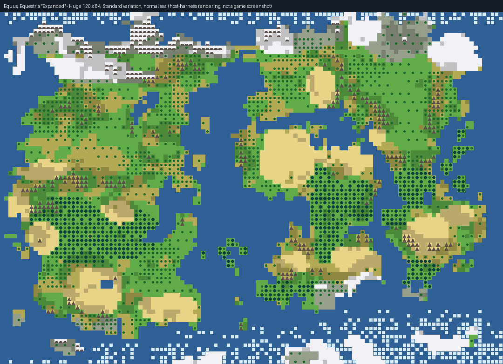

# Equus map installation and diagnostics

This is a small overlay for an existing **MLP Civilization is Magic / AdvCiv
1.14** installation. Copy `PrivateMaps/Equus.py` to the loaded mod's
`PrivateMaps` directory. Preserve the rest of the mod and its other map scripts.

## One script, two worlds

`Equus.py` now holds two atlases. The **Alternative Universe Expansions** map
option in Custom Game chooses between them:

| Choice | World | Grid |
| --- | --- | --- |
| Equestria "Known World" (default) | The regional atlas of Equestria, Griffonstone, the Dragon Coast and the Storm Realm from [`02add351`](https://github.com/SuperXANA/MLPCiv/commit/02add3513c2e5a96d3093fbd1a3b0f9696212f83) | Portrait, as before |
| Equestria "Expanded" | The whole of "Equestria... and Beyond": Equestria with Amarezonia, Ponyland, the Fields of Forever, Antleria, Zebrica, Abyssinia, the Dragon Lands, Horsetrailia and Agarica | Landscape; Huge is the mod's own 120 x 84 |

The option is the third row of the script's `CvMapOptions` table, so World Wrap
and Atlas variation keep their positions and defaults. The Known World is
unchanged: its tables and generation code are the same source, and the checks
below compare its maps with the verified original draw for draw. A game whose
stored options have no third entry is a Known World game.



The picture above is drawn by the test harness, not by the game. The Expanded
world was generated in Civilization IV once, on November 22, 2026, before its
central sea was widened; see the
[runtime evidence](docs/Equus_Runtime_Verification.md). **The widened sea has
not yet been seen in the game.**

## Reading and editing the atlas tables

Every number in the atlas tables is a fraction of the reference picture: `x`
from its west edge, `v` from its **north** edge. The Known World measures the
official map of Equestria; the Expanded tables (all named `_X_...`) measure the
map area of the larger picture, inside its ornate frame.

* **Shores** are triples of `(distance south, west shore, east shore)`. To
  widen the Celestial Sea beside Manehattan in the Expanded world, find the
  triples near `v = .21` in `_X_EQUESTRIA` and pull their east shore west. One
  table holds one stretch of land per latitude, so a landmass whose coast folds
  back is a main table plus named *arms* laid over it (`# Luna Bay's western
  arm`, `# Yucatan Ponynsula and the Changeling Kingdom`). Tables may overlap.
* **Isles, lakes, basins, passes and biomes** are ovals: center `x`, center `v`,
  then the two radii. Each carries the place name as a comment.
* **Ranges** are a half-width, a crest strength, and a path of `(x, v)` points.
* **Sea lanes** (`_X_STRAITS`) and **land links** (`_X_LAND_LINKS`) are paths
  that stay water, or stay walkable, at every map size. They are what keeps
  Equestria, Ponyland and Zebrica apart, and Horsetrailia attached, when the
  world is squeezed onto a Duel grid.
* **Sea room** (`_X_SEA_ROOM`) widens a north-south sea beyond what the picture
  draws, by moving its two shores apart and squeezing the land behind them a
  little. Its first number is the sea added on **each** side, as a fraction of
  the map's width: `.0085` is one plot on a Huge map, `.017` is two, and the
  default `.015` nearly two. `0` gives the Celestial Sea exactly as drawn.
* `EXPANDED_BRIDGES_ARE_LAND` decides what Trottingham Bridge and the
  Griffonstone rail trestle become, since Civ has no bridges: `True` (default)
  lays a one-plot causeway that armies can cross; `False` leaves a strait.

To see an edit without launching the game:

```sh
python3 tests/preview_equus.py --world 1 --size 5 --seed 7
```

## Diagnostics

Optional diagnostics are disabled by default. Set `EQUUS_DIAGNOSTICS = True`
in the installed script and `LoggingEnabled = 1` in the active Windows BtS
profile's `CivilizationIV.ini`, then restart the game. Look for `[Equus]`
records in `PythonDbg.log` and errors/tracebacks in `PythonErr.log` under that
profile's `Logs` directory. Diagnostics report stage boundaries, options, grid
dimensions, array sizes, plot/terrain counts, and feature counts through the
native Python streams. They draw no random numbers and never replace a
generation exception with a successful result.

See [installation and runtime verification](docs/Equus_Runtime_Verification.md)
for the complete procedure, expected dimensions, log locations, geographic
checks, and fresh-game save/reload tests. See
[source validation](docs/Equus_Source_Validation.md) for measured checks and
their limits.

## Checks

Run the focused checks from this branch's root:

```sh
python3 tests/check_equus.py
/path/to/python2.4 tests/check_python24.py
EQUUS_PYTHON24=/path/to/python2.4 python3 tests/check_equus.py
```

The first command uses Python 3 host test doubles. The second must be run with
an actual Python 2.4 interpreter; the game script itself requires no Python 3
tools or third-party dependencies. The third also asks that interpreter for a
checksum of each map and compares it with the Python 3 run, so that the two
cannot disagree about a single plot. `tests/fixtures/Equus_02add351.py` is the
pinned, uninstrumented Known World source for equivalence checks, not an
installable map.
