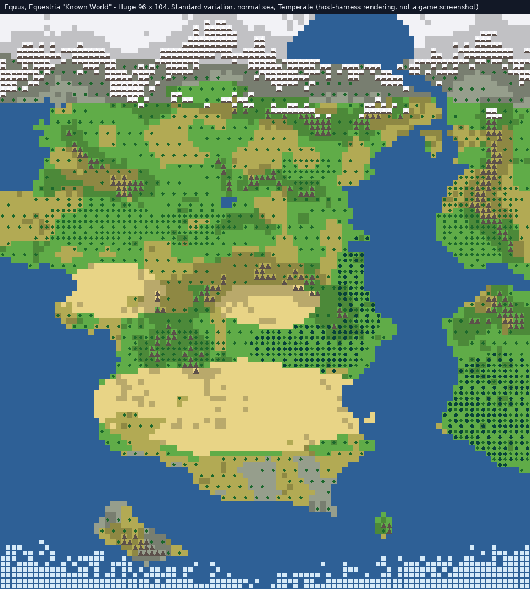
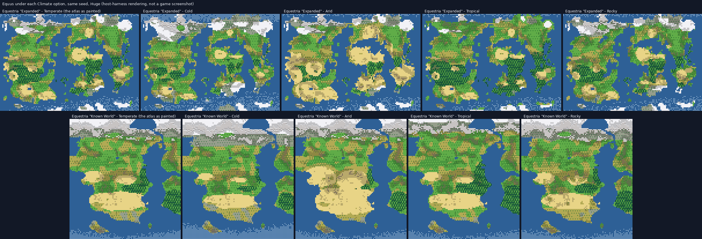

# Equus map installation and diagnostics

This is a small overlay for an existing **MLP Civilization is Magic / AdvCiv
1.14** installation. Copy `PrivateMaps/Equus.py` to the loaded mod's
`PrivateMaps` directory. Preserve the rest of the mod and its other map scripts.

## One script, two worlds

`Equus.py` now holds two atlases. The **Alternative Universe Expansions** map
option in Custom Game chooses between them:

| Choice | World | Grid |
| --- | --- | --- |
| Equestria "Known World" (default) | The regional atlas of Equestria, Griffonstone, the Dragon Coast and the Storm Realm from [`02add351`](https://github.com/SuperXANA/MLPCiv/commit/02add3513c2e5a96d3093fbd1a3b0f9696212f83), now with the Trottingham strait that makes them three continents | Portrait, as before |
| Equestria "Expanded" | The whole of "Equestria... and Beyond": Equestria with Amarezonia, Ponyland, the Fields of Forever, Antleria, Zebrica, Abyssinia, the Dragon Lands, Horsetrailia and Agarica | Landscape; Huge is the mod's own 120 x 84 |

The option is the third row of the script's `CvMapOptions` table, so World Wrap
and Atlas variation keep their positions and defaults. A game whose stored
options have no third entry is a Known World game.

## The Known World's three continents

The original script ran land across the whole top of the map, so Equestria and
Griffonstone were one continent. The official map has water there, and this
revision follows it: a sea lies behind the Yaket Range, between Mount Everhoof
and Bug Bear Territory, where the picture has its horizon, a rim of far peaks
and then sky; and from it the **Trottingham strait** runs south past Bug Bear
Territory, under the railway bridge, into the bay at Trottingham. Equestria, Griffonstone (with Bug
Bear Territory) and the Dragon lands are now three continents, of about 79%,
12% and 7% of the land. The Griffish Isles, in the strait's mouth, are an
island as the picture draws them.



* The strait is a table of **water** in the usual triples,
  `_TROTTINGHAM_STRAIT`: `(distance south, west bank, east bank)`. It is as
  narrow as the picture paints it: one plot at the bridge at low and normal
  sea level. `_TROTTINGHAM_LANES` keeps a one-plot lane open through it at
  every map size and sea level.
* Its plots are turned to ocean after the original plot pass has run, and no
  random number is drawn for it. Everywhere else the script lays out the same
  plot types and terrain as the map that was verified in the game. (In the
  game itself, rivers, forests, resources and starting positions will still
  differ from before for a given seed: the game places those afterwards, and
  it is now working with three continents.) The banks therefore do not wander
  with Atlas variation; they do follow the sea level.
* `KNOWN_BRIDGE_IS_LAND = True` lays a one-plot causeway of flat land along
  the railway, as the Expanded world does by default: armies can cross, ships
  cannot pass, and the sea north of it is closed to ships from the Celestial
  Sea.
* Emptying `_TROTTINGHAM_STRAIT` gives the map exactly as it was, land bridge
  and all. The checks below compare that with the verified original draw for
  draw.
* With the Cylinder or Toroid wrap, the west and east edges of a regional map
  meet, and Equestria touches Griffonstone again across that seam. Three
  continents is a property of the default Flat wrap.


The picture above is drawn by the test harness, not by the game. In
Civilization IV the playtester has generated and auto-played the Expanded
world with its Celestial Sea widened (reported November 28, 2026); see the
[runtime evidence](docs/Equus_Runtime_Verification.md). **The later additions (the Climate option in both worlds, the wider Inland Sea
and the two rims, and the Known World's Trottingham strait) have not yet been
seen in the game.**

## Climate and sea level

Both worlds answer the game's own **Climate** and **Sea Level** settings in
Custom Game. (The Climate setting was hidden before this revision; BtS reads a
script's settings when it starts, so restart the game after installing.)

* **Sea level** moves every coast: Low bares about a plot more land along each
  shore, High drowns about as much. It did this already.
* **Climate** moves the edge of each painted region. An atlas has no latitude
  belts to slide, so the Bone Dry Desert stays where the picture puts it and
  *swells* under Arid; under Cold every frost line creeps outward, the pack
  ice thickens and the jungles draw in; Tropical melts the snowfields to half
  and spreads the jungles; Rocky thickens the ranges that exist, without ever
  closing a pass. The Crystal Empire's valley stays green in every climate.
  Coasts never move with the climate, and Temperate is the atlas exactly as
  painted.



How far each edge moves is worked out from the game's `CIV4ClimateInfo.xml`,
measured against its Temperate entry (AdvCiv 1.14 ships none of its own, so the
stock BtS file applies). A climate that a mod adds to that XML therefore works
here without touching the script. The formulas and the resulting distances are
tabulated above `_Climate` in `Equus.py`.

## Reading and editing the atlas tables

Every number in the atlas tables is a fraction of the reference picture: `x`
from its west edge, `v` from its **north** edge. The Known World measures the
official map of Equestria; the Expanded tables (all named `_X_...`) measure the
map area of the larger picture, inside its ornate frame.

* **Shores** are triples of `(distance south, west shore, east shore)`. To
  widen the Celestial Sea beside Manehattan in the Expanded world, find the
  triples near `v = .21` in `_X_EQUESTRIA` and pull their east shore west. One
  table holds one stretch of land per latitude, so a landmass whose coast folds
  back is a main table plus named *arms* laid over it (`# Luna Bay's western
  arm`, `# Yucatan Ponynsula and the Changeling Kingdom`). Tables may overlap.
* **Isles, lakes, basins, passes and biomes** are ovals: center `x`, center `v`,
  then the two radii. Each carries the place name as a comment.
* **Ranges** are a half-width, a crest strength, and a path of `(x, v)` points.
* **Sea lanes** (`_X_STRAITS`) and **land links** (`_X_LAND_LINKS`) are paths
  that stay water, or stay walkable, at every map size. They are what keeps
  Equestria, Ponyland and Zebrica apart, and Horsetrailia attached, when the
  world is squeezed onto a Duel grid.
* **Sea room** (`_X_SEA_ROOM`) widens a sea beyond what the picture draws, by
  moving its two shores straight apart from a line and squeezing the land
  behind them a little. The line may run any way and may bend. There are four
  rows: the Celestial Sea; the Great Inland Sea and the channel that runs on
  from it between Zebrica and Horsetrailia; and one down each edge of the map,
  which pushes the land in from that rim. A row's first number is the sea
  added on **each** side of its line, as a fraction of the map's width:
  `.0085` is one plot on a Huge map, `.017` is two, and the defaults (`.015`,
  `.013` at the rims) are a plot and a half to two. `0` gives that sea exactly
  as drawn. Expanded world only.
* `EXPANDED_BRIDGES_ARE_LAND` decides what Trottingham Bridge and the
  Griffonstone rail trestle become, since Civ has no bridges: `True` (default)
  lays a one-plot causeway that armies can cross; `False` leaves a strait.

To see an edit without launching the game:

```sh
python3 tests/preview_equus.py --world 1 --size 5 --seed 7 --climate 4
```

`--climate` takes 0 Temperate, 1 Tropical, 2 Arid, 3 Rocky or 4 Cold.

## Diagnostics

Optional diagnostics are disabled by default. Set `EQUUS_DIAGNOSTICS = True`
in the installed script and `LoggingEnabled = 1` in the active Windows BtS
profile's `CivilizationIV.ini`, then restart the game. Look for `[Equus]`
records in `PythonDbg.log` and errors/tracebacks in `PythonErr.log` under that
profile's `Logs` directory. Diagnostics report stage boundaries, options, grid
dimensions, array sizes, plot/terrain counts, and feature counts through the
native Python streams. They draw no random numbers and never replace a
generation exception with a successful result.

See [installation and runtime verification](docs/Equus_Runtime_Verification.md)
for the complete procedure, expected dimensions, log locations, geographic
checks, and fresh-game save/reload tests. See
[source validation](docs/Equus_Source_Validation.md) for measured checks and
their limits.

## Checks

Run the focused checks from this branch's root:

```sh
python3 tests/check_equus.py
/path/to/python2.4 tests/check_python24.py
EQUUS_PYTHON24=/path/to/python2.4 python3 tests/check_equus.py
```

The first command uses Python 3 host test doubles. The second must be run with
an actual Python 2.4 interpreter; the game script itself requires no Python 3
tools or third-party dependencies. The third also asks that interpreter for a
checksum of each map and compares it with the Python 3 run, so that the two
cannot disagree about a single plot. `tests/fixtures/Equus_02add351.py` is the
pinned, uninstrumented Known World source for equivalence checks, not an
installable map.
